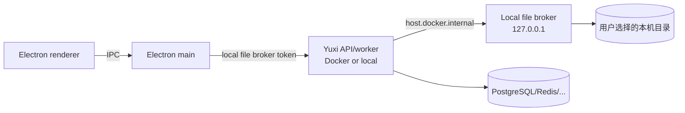
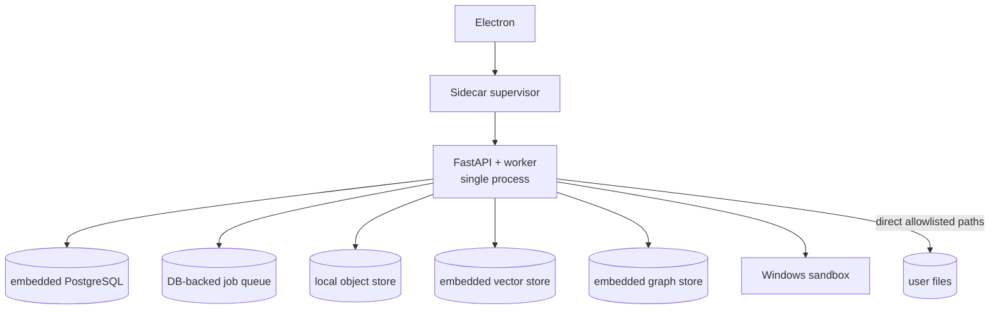

# 从 Docker 后端走向客户端优先的架构方案

状态：proposed
类型：architecture
Owner：desktop/main.js / backend/yuxi/bootstrap

## 问题

当前桌面客户端复用 Docker Compose 中的 API、worker、PostgreSQL、Redis、MinIO、Milvus、Neo4j 和沙盒服务，个人空间只能由渲染进程读取本地目录，Agent 看不到这些文件。用户希望：

1. 项目逐步脱离 Docker，以 Electron 客户端为主要运行形态。
2. Agent 能读取个人空间中选择的本地文件。

这两个目标的成本差异很大，必须分开决策。

## 结论

- **Agent 读取本地文件可以现在做**，不需要脱离 Docker：Electron 暴露带每用户 token 的只读本机文件代理，后端 Agent 通过 `host.docker.internal` 调用。
- **完全脱离 Docker 不能靠打包实现**：现有后端的数据、队列、checkpoint、对象存储、向量库、图数据库和沙盒都依赖外部服务。桌面化要么内嵌同等服务，要么替换实现并迁移数据。
- 推荐先做“混合模式”，再根据产品是否只服务单用户，决定是否投入桌面单用户版。直接重写为纯客户端 Agent 运行时不建议。

## 现状依赖

| 能力 | 当前事实 Owner | 桌面化必须处理 |
|---|---|---|
| 业务数据、租户、权限、Run/Turn | PostgreSQL + SQLAlchemy | 内嵌 PostgreSQL 或迁移到嵌入式数据库 |
| 输入投递、取消、短事件、缓存 | Redis | 替换为进程内队列或内嵌 Redis |
| 后台执行、lease、worker 健康 | ARQ worker + Redis | 单进程执行器与崩溃恢复 |
| LangGraph checkpoint | PostgreSQL checkpointer | 不能直接换 SQLite，需改持久化层 |
| 附件/对象 | MinIO | 本地对象存储适配层，迁移 bucket |
| 向量检索 | Milvus | Windows 无 Milvus Lite，需 Qdrant/LanceDB 等替代 |
| 知识图谱 | Neo4j | 内嵌图库或自带 JRE/服务 |
| Agent 文件/命令隔离 | cubesandbox / Container | Windows Job Object/AppContainer 或 WSL2 |
| API 与 worker 双进程 | Compose service | 桌面 supervisor、端口、重启、健康检查 |

结论：Docker 不是启动脚本，而是当前架构的持久化、并发和隔离边界。移除它必须逐项替换并重做失败恢复语义。

## 目标形态

### 形态 A：混合桌面（推荐先做）

- 后端仍由 Compose 或本地进程提供。
- Electron 主进程启动只读本机文件服务，只允许当前用户选中的根目录。
- 前端通过已认证 API 注册 broker 地址和短期 token；后端按用户保存，Agent 工具调用 broker。
- 渲染进程不直接持有后端可用的长期 token；preload 只暴露选择目录、状态和本地预览所需能力。
- Agent 只读；写入需要单独工具、逐次审批和审计。

**收益**：最快让 Agent 读本地文件；不改变现有 Run/Turn、权限、checkpoint 和 worker 语义。
**成本**：仍依赖 Docker 或本机服务；broker 是新的安全边界，需要 token、路径、审计测试。

### 形态 B：桌面单用户版（真正的“客户端为主”）

- Electron 负责启动、停止、升级和健康检查 Python sidecar。
- API 与 worker 合并为单进程；任务队列由 PostgreSQL/SQLite 持久化，不再依赖 Redis/ARQ。
- PostgreSQL 可内嵌便携版；MinIO 改为本地对象目录；Milvus/Neo4j 替换为 Windows 可用的嵌入式实现。
- 只支持单用户、本地模型/API Key；移除多租户、多 worker、OIDC、集群能力。
- Agent 文件工具直接访问授权目录，不再经过 HTTP broker；路径校验、符号链接防护和审计仍是硬要求。

**这不是当前代码的打包，而是产品分叉。** 需要重新定义哪些能力保留：知识库、图谱、评估、技能、MCP、沙盒、定时任务。

### 形态 C：纯客户端重写

Agent runtime、队列、持久化、检索全部改用 TypeScript，删除 Python 后端。功能对齐成本最高，且与现有 LangGraph/DeepAgents/工具生态脱节，不建议。

## 分阶段实施

### Phase 0：边界确认

交付架构决策记录、支持矩阵、数据迁移/回滚方案、明确 Windows-first 与单用户假设。未确认前不删除任何 Compose 服务。

### Phase 1：本机文件代理（保留 Docker）

1. Electron main 新增 broker：仅 `127.0.0.1`，每用户 token，目录根绑定 uid/session。
2. 接口先只读：列表、读文本/图片/二进制元数据；限制单文件大小、深度和数量；不执行、不写入。
3. 前端注册 broker 到后端；token 只进密钥存储，不进日志、prompt 或模型上下文。
4. 后端新增 Agent 工具：查询当前用户授权根目录、列目录、读文件；工具输出标记为不可信内容。
5. Docker 通过 `host.docker.internal` 访问；服务端校验 token、uid、路径、速率。
6. 负向测试：错误 token、跨 uid、`..`、符号链接、已撤销目录、超大文件、并发删除。
7. 验收：Agent 在真实 Electron + Compose 环境下读取选中目录文件，且无法读取根目录外文件。

### Phase 2：去掉 Compose 启动依赖（sidecar 原型）

1. Electron 管理 Python 进程、日志、端口、健康检查和重启。
2. 保留外部 PostgreSQL/Redis/MinIO/Milvus/Neo4j，仅把启动从 Compose 移到 sidecar。
3. 解决 PyInstaller/依赖、uv、迁移、端口冲突、进程退出和升级。
4. 验收：不执行 `docker compose` 也能启动 API/worker 并完成一条 Agent Run；外部服务仍由用户提供。

### Phase 3：替换有状态依赖

按风险从低到高：

| 顺序 | 替换 | 原因 |
|---|---|---|
| 1 | MinIO → 本地对象目录 | 接口边界清晰，可双写迁移 |
| 2 | Redis/ARQ → PostgreSQL 任务队列 | 保留持久化与崩溃恢复，去掉 Redis |
| 3 | Milvus → 嵌入式向量库 | 需要重建索引和检索回归，Windows 兼容性先验证 |
| 4 | Neo4j → 嵌入式图存储 | 需要重写图查询和迁移 |
| 5 | 沙盒 → Windows 隔离 | 安全风险最高，必须单独威胁建模 |

每一步都要提供双实现、迁移脚本、回滚开关和真实链路测试；不允许静默降级。

### Phase 4：单用户桌面版

- 合并 API/worker，简化多租户与部署配置。
- Electron 打包 Python sidecar、迁移、模型依赖和更新器。
- 数据目录、备份、卸载、崩溃恢复、升级迁移形成产品合同。
- 同一台机器多用户场景明确不支持，或改用独立数据目录实例。

## Agent 本地文件设计（Phase 1）

### 信任边界

- 用户选择目录 = 授权根目录；broker 不递归扫描整盘。
- 目录句柄/根路径绑定当前登录 uid；切换用户或撤销后 token 失效。
- 服务端不能信任 Agent 传来的路径；broker 重新做 `realpath` 和根目录包含校验。
- Agent 工具只返回受限内容；文件内容中的指令不获得系统权限。
- 不把 token 写入 Agent 消息、事件、artifact、日志或错误详情。

### 接口草案

- `GET /v1/files?path=<relative>&depth=1`：一层目录，过滤系统目录。
- `GET /v1/files/content?path=<relative>`：文本截断或二进制元数据。
- 服务端工具：`list_local_files`、`read_local_file`。
- 响应包含 `root_id`、`truncated`、`size`、`mime`；不返回真实绝对路径。

### 失败与撤销

- 应用关闭、用户断开、目录删除、token 过期、uid 变化都必须让工具返回结构化失败，而不是空结果。
- Agent 收到失败后不得猜测相邻文件；Run 记录工具错误和审计事件。

## 数据迁移

- PostgreSQL：便携版初始化 → 现有 dump 导入 → schema 版本校验；保留原卷只读回滚点。
- MinIO：对象 key 不变迁移到本地目录，校验 checksum 后切读路径。
- Milvus：导出 collection 元数据，重新写入新向量库；embedding 可重建，但成本需评估。
- Neo4j：导出节点/关系，按新图存储 schema 重建；查询语义需要回归。
- 不允许“首次启动自动迁移后删除旧数据”；迁移必须可审计、可重试。

## 安全与隔离

- Windows 沙盒不能等同容器隔离；需要明确进程、文件、网络、凭据边界，并做逃逸测试。
- Electron broker 仅 loopback，token + uid + 根目录三重校验；禁止上传本地内容到服务端日志。
- Python sidecar 以当前用户运行，仍可能读取用户其他文件；Agent 工具必须与 sidecar 权限分离（broker/受限进程）。
- 更新包和 sidecar 需要签名、校验和回滚；模型 Key 存 OS 凭据库。

## 风险

| 风险 | 影响 | 缓解 |
|---|---|---|
| 功能缩水 | 知识库、图谱、多用户能力丢失 | 明确桌面版支持矩阵，不承诺全功能 |
| 数据迁移失败 | 会话、知识库、索引不可用 | 迁移预演、双写、备份、回滚 |
| 沙盒逃逸 | 本机文件/凭据泄露 | 独立威胁建模、最小权限、禁用高风险工具 |
| sidecar 崩溃 | Run 卡住/重复执行 | lease、恢复、幂等和启动自检 |
| 安装包体积和杀软误报 | 无法分发 | 分阶段裁剪依赖、签名与白名单沟通 |
| 端口/防火墙 | 后端不可达 | 固定 loopback、冲突检测、清晰错误 |
| 索引重建成本 | 知识库上线延迟 | 后台重建、进度与回滚 |

## 验收与决策门

Phase 1 完成后回答：Agent 是否能稳定读取本地文件，且无跨用户/越界读取。
Phase 2 完成后回答：没有 Compose 启动是否仍能完成完整 Run。
Phase 3 每项替换后回答：真实 PostgreSQL/HTTP/worker 语义是否仍成立，失败是否可观察。
Phase 4 前必须确认：单用户桌面是否是产品目标；是否接受知识库/图谱/多用户能力缩减。

## 当前建议

先实施 Phase 1。它直接解决 Agent 读取个人空间的问题，风险局限在新增 broker 和工具；不触碰 Run/Turn、权限和持久化核心。等 Phase 1 稳定后，再决定是否投入 Phase 2/3 的桌面单用户分叉。不要在没有迁移与回滚方案前删除 Docker 服务。
